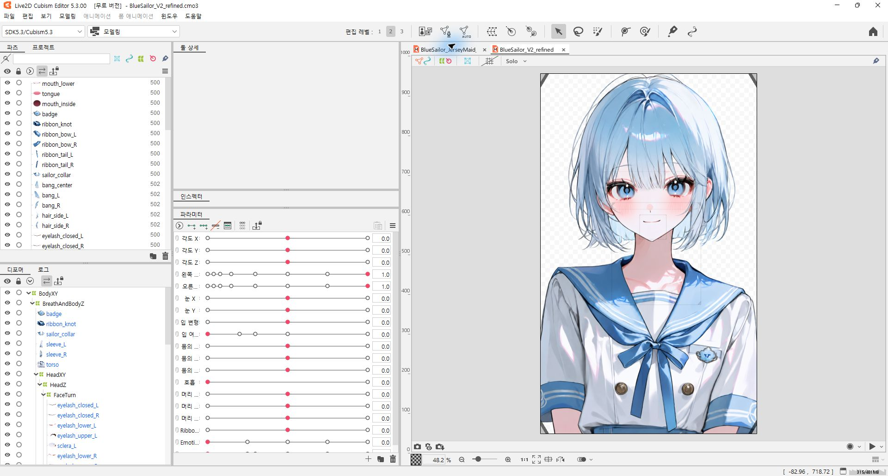
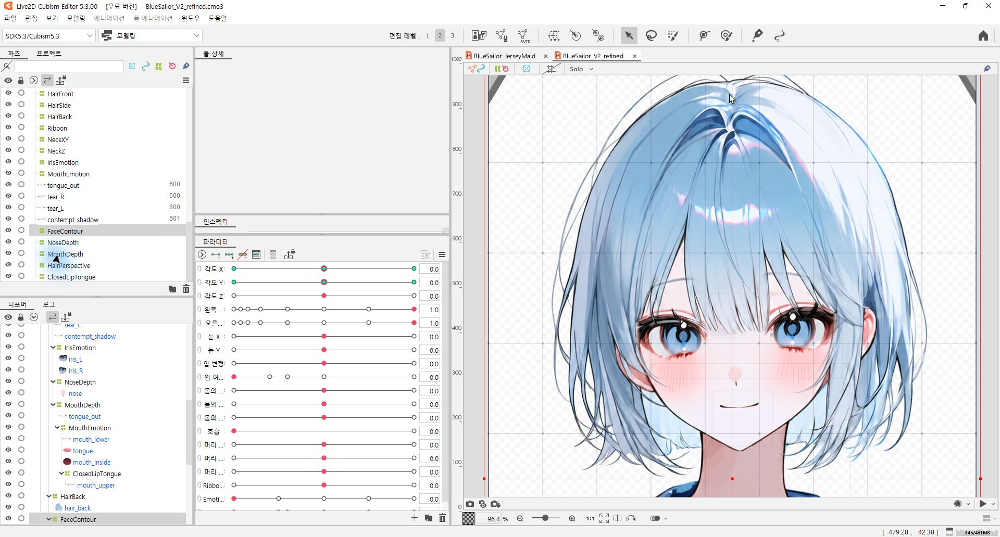
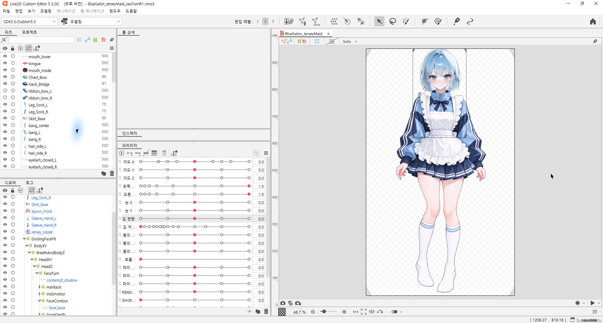
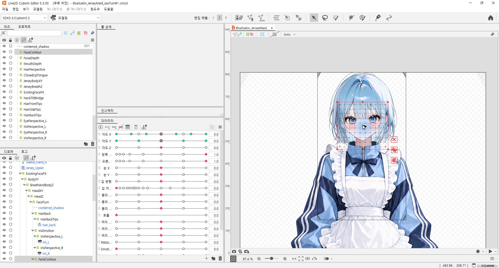

# AI로 버튜버 Live2D 리깅 작업해 보기

캐릭터 이미지 한 장을 가지고 AI로 어디까지 Live2D 리깅을 할 수 있는지 작업해 봤습니다. Codex에 제작 목표와 작업 순서, 검수 기준을 프롬프트로 전달하고, 나온 결과를 확인하면서 수정하는 방식으로 진행했습니다.

목표는 원래 그림의 인상을 유지하면서 눈과 입, 고개, 머리카락이 움직이는 모델을 만드는 것이었습니다. 파츠 분리부터 PSD 제작, Cubism 리깅, VTube Studio에서 사용할 실행 파일 구성까지 이어서 작업했습니다.

현재까지 만든 세일러복과 메이드복 모델의 작업 화면, 진행 과정, 사용한 프롬프트를 정리했습니다.

**[리깅 모델 다운로드](models/README.md)** · **[사용한 프롬프트 전문](prompts/live2d-vtuber-production-prompt.md)** · **[원문 TXT](prompts/live2d-vtuber-production-prompt.txt)** · **[버전별 작업 기록](docs/production-notes.md)**

## 리깅 모델 파일

두 모델의 **Cubism 편집 원본(.cmo3)**과 **VTube Studio 실행 파일**도 함께 올렸습니다.

- [세일러복 V2 refined 편집 원본](models/sailor/editable/BlueSailor_V2_refined.cmo3)
- [메이드복 JawTurn R1 편집 원본](models/jersey-maid/editable/BlueSailor_JerseyMaid_JawTurnR1.cmo3)
- [실행 폴더와 사용 방법](models/README.md)

전체 파일은 저장소 상단의 **Code → Download ZIP**으로 받을 수 있습니다. VTube Studio용 모델은 텍스처와 물리·표정 설정이 필요하므로 실행 폴더 전체를 함께 사용해 주세요.

## 작업 결과

Live2D Cubism Editor 5.3.00 FREE에서 편집 파일을 열어 캡처한 화면입니다. 파츠가 어떻게 나뉘어 있고 어떤 파라미터에 연결되어 있는지 볼 수 있도록 목록과 디포머를 함께 표시했습니다.

### 세일러복 버전

처음 작업한 상반신 모델입니다. 눈과 입, 머리카락, 세일러 칼라와 리본 등을 분리하고 움직임을 연결했습니다. 이후 눈을 감을 때 선이 겹치는 부분과 얼굴 회전, 입 모양 등을 수정했습니다.

캡처한 파일은 `BlueSailor_V2_refined.cmo3`입니다.

얼굴 윤곽 디포머를 선택한 화면입니다. 얼굴에 적용한 변형 격자와 각도 파라미터의 키를 같이 볼 수 있습니다.

### 저지 메이드복 버전

이후에는 전신 의상이 있는 메이드복 버전으로 작업을 이어갔습니다. 얼굴과 머리카락뿐 아니라 몸과 의상의 움직임도 다듬고, 고개를 돌릴 때 턱과 목이 연결되는 부분을 추가로 보정했습니다.

캡처한 파일은 `BlueSailor_JerseyMaid_JawTurnR1.cmo3`입니다.

## 작업은 이렇게 진행했습니다

### 1. 프롬프트에 목표와 실패 기준 정리하기

처음부터 눈 깜빡임, 입 개폐, 시선 이동, 고개 회전, 몸통과 호흡, 머리카락과 리본 물리를 목표로 잡았습니다. 사용 환경은 Cubism FREE와 VTube Studio이고, 최종적으로는 iPhone Face ID 추적에 연결하는 것을 목표로 했습니다.

프롬프트에는 해야 할 일뿐 아니라 다시 수정해야 하는 기준도 넣었습니다. 눈을 감았는데 홍채가 보이거나, 입을 닫았는데 입 안이 노출되거나, 고개를 돌릴 때 목이 떨어지는 경우에는 다음 단계로 넘어가지 않도록 했습니다.

### 2. 원본 보존과 파츠 분리

원본은 따로 보존하고 복사본으로 작업했습니다. 얼굴, 흰자, 홍채, 속눈썹, 입 선과 내부, 앞머리·옆머리·뒷머리, 목, 몸통, 소매와 리본 등을 나눴습니다.

한 장의 그림에는 가려진 영역의 정보가 없어서, 움직였을 때 드러나는 영역도 보완해야 했습니다. 이미지와 PSD 처리는 Python을 활용했고, 숨은 뒷머리 보완에는 이미지 생성도 사용했습니다. 분리한 파츠를 다시 합성해서 원본과 비교하는 과정도 거쳤습니다.

초기에는 33개 파츠로 시작했고, 이후 세일러복 V2 보정 과정에서 37개 ArtMesh와 37레이어 PSD로 확장했습니다.

### 3. 파라미터와 디포머 연결

좌우 눈은 각각 독립적으로 감기도록 구성했습니다. 시선은 X/Y로, 입은 개방 정도와 형태를 조합해 움직이도록 했습니다.

- 눈 개폐: `ParamEyeLOpen`, `ParamEyeROpen`
- 시선: `ParamEyeBallX`, `ParamEyeBallY`
- 입: `ParamMouthOpenY`, `ParamMouthForm`
- 머리: `ParamAngleX/Y/Z`
- 몸통과 호흡: `ParamBodyAngleX/Y/Z`, `ParamBreath`

얼굴, 눈, 입, 머리카락의 변형을 계층으로 연결하고, 머리카락과 리본에는 별도의 물리 그룹을 구성했습니다. Cubism FREE 환경에서 작업하다 보니 파라미터와 디포머를 불필요하게 늘리지 않는 것도 신경 썼습니다.

### 4. VTube Studio 연결과 수정

편집용 CMO3 외에 MOC3, 모델 참조 JSON, 물리 설정, 텍스처를 구성했습니다. 초기에는 SDK 5.3 출력과 설치된 VTube Studio Core 사이에 호환 문제가 있어서 SDK 4.2로 다시 내보냈습니다.

작업 중에는 VTube Studio와 로컬 API의 모의 입력을 이용해 눈, 입, 시선, 회전과 물리 반응을 확인했습니다. 놀람, 웃음, 경멸, 울음, 혀 내밀기 같은 표정도 추가했습니다.

### 5. 결과를 보면서 반복 보정

세일러복 버전에서는 반쯤 감은 눈의 선 겹침, 눈꼬리 경계, 턱과 뒷머리의 회전, 혀와 닫힌 입 선을 보정했습니다. 메이드복 버전에서는 얼굴과 목, 머리카락을 여러 차례 수정했고, 마지막에는 턱 끝이 지나치게 옆으로 움직이는 부분과 목의 회전 추종을 조정했습니다.

전체 과정은 **제작 → 미리보기 → 문제 확인 → 수정 → 다시 확인**의 반복이었습니다. 프롬프트 한 번으로 끝내기보다는 실제 결과를 보면서 수정 방향을 전달하고 버전을 쌓아가는 방식에 가까웠습니다.

## 사용한 도구와 작업 방식

- **Codex:** 파일 작업, 파츠 처리와 리깅 구성, 프로그램 조작, 검사와 수정
- **Python:** 이미지·PSD 처리와 검증 스크립트
- **Live2D Cubism FREE:** 모델 편집과 내보내기
- **VTube Studio:** 모델 로드와 입력 매핑, 실행 확인

저는 원본 이미지와 제작 조건을 전달하고, 결과를 확인하면서 원하는 외형과 수정 방향을 정했습니다. 파츠 처리와 파일 구성, 프로그램 조작 등은 AI 에이전트를 활용했습니다.

## 아직 더 다듬고 싶은 부분

기본 동작을 구성하고 실행 파일까지 만들었지만, 모든 부분이 완성됐다고 보기는 어렵습니다. 특히 정면 이미지 한 장으로 만드는 얼굴 회전에는 한계가 있어서, 큰 각도에서는 턱과 목 주변의 경계가 드러나는 부분을 더 다듬어야 합니다.

입의 A/E/I/O/U 형태는 두 파라미터의 조합으로 표현한 것이고, 음성을 인식해 음소를 자동으로 선택하는 기능은 아닙니다. 초기 버전에서 iPhone 입력을 보정한 기록은 있지만, 여기 올린 두 최종 보정본은 수정 후 iPhone 실기 검증까지 마친 상태는 아닙니다.

버전별 수정 내용과 확인 범위는 [작업 기록](docs/production-notes.md)에 정리했습니다.

## 사용한 프롬프트

작업을 시작할 때 Codex에 전달한 프롬프트도 함께 올렸습니다. 원본 보호, 파츠 분리와 복원, PSD 제작, 단계별 리깅, FREE 제한, VTube Studio 연결, 자기 검수 기준까지 담았습니다.

**[프롬프트 전문 보기](prompts/live2d-vtuber-production-prompt.md)**

이 프롬프트는 처음 세일러복 상반신 모델을 만들 때 사용한 출발점입니다. 이후 메이드복 버전과 세부 보정은 추가 요청과 수정을 거쳐 진행했습니다.

현재 저장소에는 작업 소개와 Cubism 캡처, 프롬프트, 두 모델의 CMO3 편집 원본과 VTube Studio 실행 파일을 올려두었습니다.
