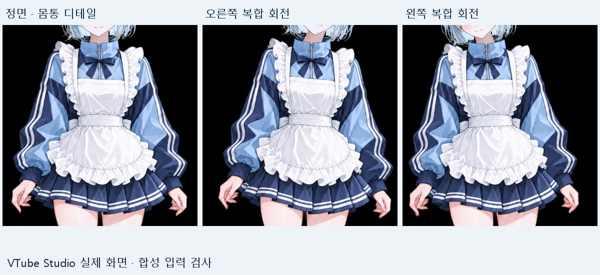
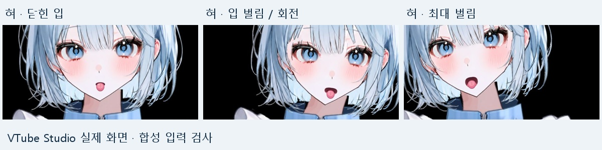
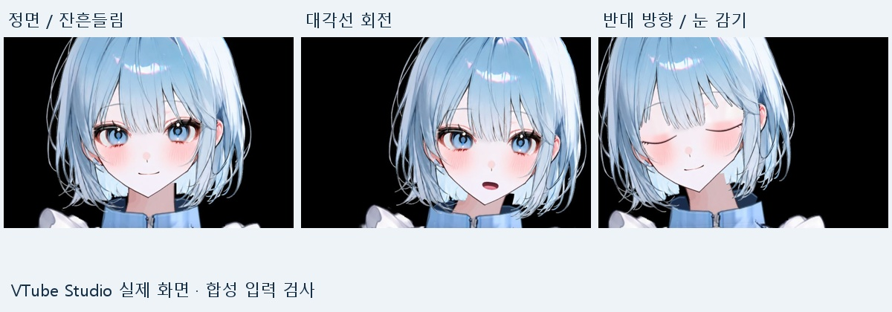

# 실제 파일로 돌아본 제작과 보정 과정

> 이 글은 Codex를 활용해 작성했습니다. 리깅 작업은 Codex에서 GPT-6 Astra 모델을 사용해 진행했고, 제가 제작 조건과 수정 방향을 정하며 결과를 확인했습니다.

구버전 작업 폴더를 다시 살펴보니 완성 모델 외에도 이미지 생성 프롬프트, 제작 코드, 실패한 초안의 검사 코드, 입력 보정 전후 데이터가 남아 있었습니다. 앞서 정리한 [파츠 분리와 얼굴·목 보정](rigging-retrospective.md)에 이어, 실제로 어떤 파일을 만들고 무엇을 바꿨는지 더 자세히 정리했습니다.

아래 내용은 여러 구버전의 기록입니다. 서로 다른 단계의 수치와 검사를 최종 모델 하나의 결과로 합치지 않았습니다. 그림에 담긴 모습은 당시 VTube Studio에서 모의 입력으로 확인한 화면이며, iPhone 실기 자료는 별도로 표시했습니다.

## 1. 제작 지시와 이미지 보완 프롬프트를 나눠 사용

[처음 전달한 제작 프롬프트](../prompts/live2d-vtuber-production-prompt.md)는 전체 목표와 작업 순서, 검수 기준을 담았습니다. 실제 파츠를 만드는 과정에서는 목적에 맞춰 더 좁은 이미지 편집 요청을 추가했습니다. [당시 이미지 생성 프롬프트 원문](../prompts/image-generation-prompts.md)도 함께 올렸습니다.

회전 참고 이미지는 좌우 yaw와 정면의 세 패널을 요청했습니다. 고개 기울기와 좌우 회전이 섞이지 않도록 눈높이, 목 방향, 여백을 구체적으로 지정했습니다. 별도의 16칸 참고 시트에는 눈 개폐, 입 모양, 고개 X/Y 방향을 넣었습니다. 이 시트는 리깅을 설계하기 위한 참고 그림이며, 그 자체가 움직이는 모델은 아닙니다.

얼굴 바탕을 만드는 요청은 더 세밀했습니다. 원본 캔버스 971×1620을 유지하고, 보이는 피부와 턱 위치를 보존하면서 눈·코·입을 제거하고 앞머리에 가려진 피부를 채우도록 했습니다. 얼굴 밖은 투명하게, 얼굴 내부는 불투명하게 만들어 파츠로 합성할 수 있도록 요구했습니다.

프롬프트에 적은 조건은 목표입니다. 실제 결과가 그 조건을 모두 충족했다는 뜻은 아니어서, 생성 후 파츠 합성과 경계 확인이 필요했습니다.

## 2. PSD 파일 검사와 그림 품질 검사를 따로 진행

[초기 PSD 제작 코드](../examples/historical/write_layered_psd.py)는 파츠의 알파 영역을 기준으로 레이어를 만들고, 이름·위치·표시 상태를 저장합니다. 저장한 PSD를 다시 열어 레이어 수와 캔버스 크기를 검사하고, 각 파츠를 원래 위치에 복원해 투명도와 보이는 픽셀이 같은지 비교합니다.

이 코드에서 특히 남겨 두고 싶었던 부분은 실패 상태를 구분한 점입니다. 출력 이름은 `character_parts_v006_QA_FAILED_DRAFT.psd`이고, 검사 보고서에는 `DRAFT_ART_QA_FAILED` 상태를 기록하도록 되어 있습니다. 파일 형식 검사를 통과해도 원화 품질 검수를 통과한 완성품으로 취급하지 않았습니다. Cubism 가져오기, 리깅, iPhone 검사는 이 초안에서 별도 미검사 항목으로 남겼습니다.

이 코드는 당시 작업 방식을 보여주는 자료입니다. 이번에 다시 실행해 같은 검사 결과를 재현한 것은 아니며, 현재 배포 모델의 품질 수치로 사용하지 않았습니다.

## 3. 몸통과 의상은 고정되는 부분부터 잡기

BodyMotion 단계에서는 얼굴을 다시 만드는 대신 몸통과 의상 움직임을 보강했습니다. 몸통 X/Y 키를 3×3에서 5×5로 늘리고, 정면 근처에서 폭이 급하게 바뀌지 않도록 조절했습니다.

소매는 어깨 쪽의 변형을 억제하고 아래팔과 손목 쪽으로 갈수록 더 움직이도록 했습니다. 치마와 앞치마는 허리에서 변형량이 0으로 시작해 아래로 갈수록 커지게 하고, 끝부분에 작은 물결을 더했습니다. 가슴 리본 역시 뿌리는 유지하면서 끝의 반응을 보강했습니다. 손가락이나 팔꿈치를 독립적으로 추적하는 구성은 아닙니다.

[제작 코드](../examples/historical/build_body_motion.py)에는 변경 대상 다섯 메시를 지정하고, 나머지 메시의 키폼이 이전과 같은지 비교하는 검사가 들어 있습니다. [기하 검사 기록](../evidence/geometry/body_geometry.json)에는 소매 좌우·치마·앞치마 각 25키폼, 가슴 리본 5키폼, 몸통 워프 25키폼이 남아 있습니다. 다른 32개 메시의 키폼은 유지했습니다.

삼각형 방향 검사는 변형 과정에서 메시가 뒤집히는 오류를 찾기 위한 것입니다. 그 검사를 통과했다고 의상 주름이 모든 각도에서 자연스럽다는 뜻은 아닙니다. 정면과 양방향 복합 회전 화면으로 목·어깨·허리의 연결도 확인했습니다. [당시 BodyMotion 보고서](archive/BodyMotion.md)

## 4. iPhone에서 입이 충분히 안 벌어지는 문제

BodyMotion 이후에는 리깅 형상보다 입력 매핑을 손볼 필요가 있었습니다. 실제 iPhone 추적에서 입을 벌려도 모델의 최대 입 벌림 출력이 약 0.60에 머물렀습니다. MouthResponse 단계에서는 모델 MOC를 유지하고 VTube Studio의 입 벌림 매핑만 바꿨습니다.

- 입력 범위: `0~1`에서 `0.012~0.60`으로 변경
- 출력 범위: `0~1` 유지
- Smoothing: `5`에서 `2`로 변경
- 작은 입력은 닫힌 입으로 처리하도록 하한 설정

[변경 설정 원문](../evidence/calibration/mouth_mapping_change.json)과 [보정 전 90개 샘플](../evidence/calibration/iphone_mouth_before.json), [보정 후 100개 샘플](../evidence/calibration/iphone_mouth_after.json)을 함께 올렸습니다. 이번 정리 때 JSON의 `ParamMouthOpenY`를 다시 집계하니 보정 전 범위는 약 0.0017~0.5987, 보정 후 범위는 약 0~0.9998이었습니다.

이 샘플은 모델 출력값이며 원시 카메라 영상이나 동일 동작을 동기화한 비교가 아닙니다. 입력 감도는 범위상 약 1.7배로 바뀌었지만, 지연 시간이 얼마나 줄었는지 측정한 자료는 아닙니다. 당시 기록에는 제가 iPhone에서 자연스러워졌다고 확인한 내용이 남아 있습니다. 이 확인은 MouthResponse 단계의 입 감도에 관한 것입니다. [당시 보고서](archive/MouthResponse.md)

그보다 앞선 세일러복 v011에서도 실기 보정을 했습니다. 눈이 반쯤 열린 것처럼 보이는 문제를 줄이려고 눈 입력 범위를 `0.05~0.45`, 출력을 `0~1`로 조정했습니다. 머리카락 출력 Scale도 앞·옆·뒤 각각 `2.0 / 1.8 / 1.6`으로 조정했습니다. 큰 움직임에서는 출력이 ±1 한계에 닿았고, 모든 동작에서 포화가 없었다고 기록하지는 않았습니다. 이 설정은 당시 사용자와 환경에 맞춘 값입니다. [v011 실기 보정 기록](archive/iphone-calibration-v011.md)

## 5. 혀를 입 벌림에 함께 연결

TongueAlign 단계에서는 혀가 입보다 위에서 시작하는 느낌을 수정했습니다. 기존 원화 좌표에서 7px 아래로 옮기고, 입을 벌릴수록 최대 14px를 더 내려 혀 뿌리가 입 안에 연결되도록 했습니다.

혀 내밀기 5단계와 입 벌림 5단계를 조합해 25키폼으로 구성했습니다. [제작 코드](../examples/historical/build_tongue_align.py)에서 혀의 세로 위치 보정은 `(7 + 14 × 입 벌림 값) / 캔버스 높이`로 적용됩니다. 나머지 36개 메시 키폼이 달라지지 않았는지도 비교합니다.

이미지 왼쪽의 ‘닫힌 입’은 입 벌림 입력 상태를 나타내는 당시 표기입니다. 혀 표정이 켜져 있으므로 입이 시각적으로 완전히 닫혀 있다는 의미는 아닙니다. 닫힘·중간·최대 벌림과 회전 조합을 모의 입력으로 확인했고, 앞서 실기 확인한 입 감도 설정은 유지했습니다. 새 혀 위치까지 iPhone에서 확인한 것은 아닙니다. [당시 보고서](archive/TongueAlign.md)

## 6. 머리카락 전체 흔들림에서 머리끝 반응으로

HairBreeze 단계는 FaceVolume을 바탕으로 머리끝의 움직임을 추가한 버전입니다. 앞머리·옆머리·뒷머리에 끝부분 전용 워프를 하나씩 추가하고 총 75키폼을 구성했습니다. 기존 22개 워프와 37개 메시 키폼은 유지하면서 머리 메시 6개의 부모를 새 변형에 연결했습니다.

머리 물리는 3단 진자로 구성해 앞머리가 더 빠르고 옆·뒷머리가 더 느리게 반응하도록 했습니다. 머리끝이 다른 구역의 입력도 조금 늦게 따라가도록 연결하고, 자동 호흡을 약하게 섞었습니다. 정지 중에도 작은 움직임이 남는 구성으로, 실제 바람이나 iPhone에서 측정한 호흡을 재현한 것은 아닙니다.

[물리 검사 원문](../evidence/geometry/hair_dynamics_final.json)은 작은 움직임 7초, 빠른 회전 9초, 중립 10초의 모의 입력 기록입니다. 해당 검사에서 앞머리·옆머리·뒷머리 출력의 `clipped_fraction`은 모두 0이었습니다. 다만 자동 호흡에 연동된 움직임이 있어 마지막 출력이 모두 0으로 멈추지는 않습니다. [정지 구간 기록](../evidence/geometry/idle_motion_check.json)도 별도로 남겼습니다.

정지 이미지로는 반응 속도나 지연을 보여줄 수 없어서, 위 캡처는 외형과 경계 확인용으로 보고 움직임에 대한 설명은 측정 기록과 함께 읽도록 했습니다. [당시 HairBreeze 보고서](archive/HairBreeze.md)

## 7. 제작 코드를 공개한 범위

작업 폴더에는 제작·보정·검사·패키징용 Python 스크립트가 245개 있었습니다. 이번에는 내용을 확인한 PSD 제작, 몸통 보정, 혀 보정 코드 세 개를 [과거 제작 코드](../examples/historical/README.md)에 넣었습니다.

이 파일들은 당시 보조 모듈과 이전 버전의 파츠·CMO3를 읽고 다음 버전을 쓰는 방식입니다. 코드 세 개만 다운로드해 전체 모델을 재생성하는 독립 실행 패키지는 아닙니다. 당시 원본 코드를 보관해 작업 방식을 설명하는 목적이며, 실행 안내나 새로 검증한 빌드 도구로 제시하지 않았습니다.

## 이번 자료가 보여주는 것

이미지 한 장에서 모델을 만들 때는 파츠를 나누는 일, 가려진 그림을 복원하는 일, 변형을 만드는 일, 실제 추적 입력에 맞추는 일이 각각 필요했습니다. 특히 입력 매핑을 조정하는 것만으로 해결된 문제와 파츠 그림이나 키폼을 수정해야 해결된 문제를 구분하면서 작업했습니다.

구버전에서 실기 확인한 항목이 있어도 이후의 모든 보정본까지 검증한 것은 아닙니다. 현재 공개한 두 최종 모델은 수정 후 iPhone 실기 전체 재검증이 남아 있습니다. [현재 모델과 사용 방법](../models/README.md), [버전별 기록](production-notes.md)을 함께 참고해 주세요.

## 최종 후기

한 달 정도 GPT-6 Astra로 버튜버 리깅을 작업해 봤습니다. 파츠를 나누고 기본적인 움직임을 연결하는 데까지는 도달했지만, 사람이 세심하게 작업한 리깅과 비교하면 아직 많이 부족하다고 느꼈습니다.

작업하면서 가장 어려웠던 것은 디테일과 움직임, 각도를 함께 맞추는 일이었습니다. 정면에서 괜찮던 얼굴도 옆으로 돌리면 윤곽이나 파츠 경계가 어색해졌고, 눈 감기와 입 벌림처럼 여러 동작이 겹치면 따로 볼 때 놓쳤던 문제가 드러났습니다. 한 부분을 수정한 뒤에는 다른 각도와 동작에서도 자연스러운지 다시 확인해야 했습니다. 움직임의 강약과 타이밍, 얼굴의 인상을 유지하는 것까지 고려할 부분이 많았습니다.

AI로 실제 움직이는 모델을 만들어 본 경험은 의미 있었지만, 지금 단계에서 제가 기대한 완성도의 버튜버 리깅을 AI에 맡기기에는 아직 부족하다는 생각입니다. 파일이 정상적으로 열리고 파라미터가 움직이는 것만으로는 충분하지 않았습니다. 최종 결과를 자연스럽게 만들려면 사람이 세밀하게 보고 판단하며 다듬는 작업이 여전히 많이 필요하다는 것이 이번 작업의 솔직한 후기입니다.
