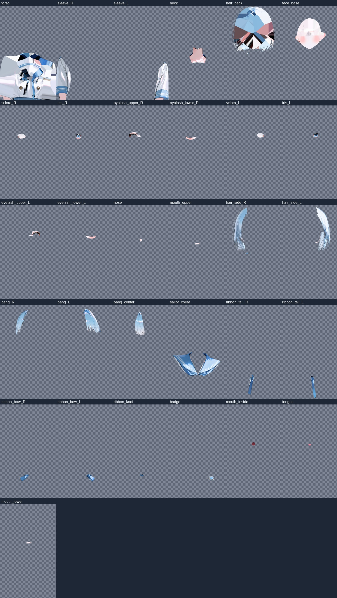
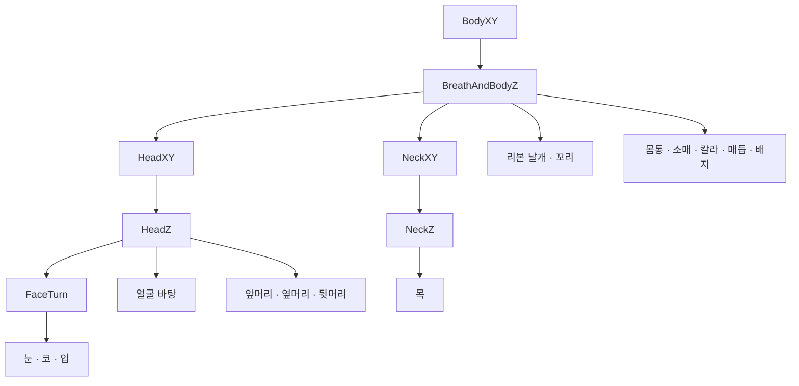
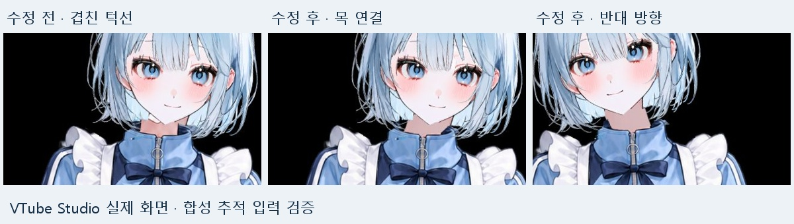
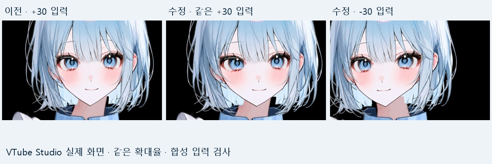

# 파츠 분리부터 턱과 목 보정까지

이어서 읽기: [이미지 보완 프롬프트·제작 코드·의상과 물리·iPhone 보정의 상세 과정](detailed-workflow.md).

완성 화면만 보면 어떤 작업을 했는지 잘 드러나지 않아서, 구버전 파일에 남아 있던 파츠 도판과 비교 화면을 다시 정리했습니다. 처음부터 지금 모습이 나온 것은 아니고, 파츠를 나누고 움직여 본 뒤 어색한 부분을 수정하는 과정을 반복했습니다.

아래 이미지는 당시 보관한 작업 자료입니다. 파츠 도판은 초기 세일러복 v008, 목 비교는 메이드복 NeckFix, 얼굴 비교는 FaceVolume 단계입니다. 현재 배포한 최종 파일을 같은 날 다시 촬영한 비교는 아닙니다.

## 1. 한 장의 그림을 움직일 수 있는 파츠로 나누기

얼굴과 몸을 크게 나누는 것만으로는 눈 깜빡임이나 시선 이동을 만들 수 없었습니다. 눈은 흰자·홍채·위아래 속눈썹으로, 입은 입 선·입 안·혀로 나누고, 머리카락도 앞머리·양쪽 옆머리·뒷머리로 분리했습니다. 의상은 몸통, 소매, 세일러 칼라, 리본 날개와 꼬리, 매듭, 배지 등으로 나눴습니다.

이 도판은 파츠를 각각 원래 캔버스 위치에 놓고 보여주는 중간 작업 자료입니다. 작은 눈동자나 입이 빈 공간에 떠 있는 것은 합성할 때 원래 위치를 맞추기 위한 것입니다. 완성 버전의 전체 레이어 목록은 아니며, 이후 별도 눈 선과 보정 파츠가 추가되었습니다.

분리 후에는 파츠를 다시 합성해 원본 인상이 유지되는지 확인했습니다. 동시에 앞머리 뒤의 피부나 머리카락 안쪽처럼 원본에서 가려진 부분도 보완했습니다. 도판에 보이는 뒷머리와 얼굴 바탕의 패치 흔적은 이런 중간 복원 작업을 보여줍니다. 정면에서 가려진다고 끝나는 것이 아니라, 회전했을 때 드러나는 경계까지 확인해야 했습니다.

초기 v009는 33개 ArtMesh로 구성했고, 이후 세일러복 V2 refined에서는 37개 ArtMesh와 37레이어 PSD로 확장했습니다. 서로 다른 버전의 파츠 수를 하나의 최종 수치로 섞지 않았습니다.

## 2. 움직임을 묶는 리깅 구조

초기 v009에서는 몸통을 기준으로 머리, 목, 리본의 움직임을 나눴습니다. 아래는 당시 구조를 간단히 정리한 것입니다. 현재 두 배포본의 전체 디포머 트리를 그대로 옮긴 도식은 아닙니다.

눈동자는 흰자를 마스크로 사용해 눈 밖으로 나가지 않도록 했습니다. 눈 개폐는 좌우를 따로 연결하고, 감은 눈 선은 별도 레이어로 구성했습니다. 눈동자 자체에는 시선 X/Y를 연결하고 머리 회전은 상위 디포머에서 전달하는 방식입니다.

입 안과 혀는 `ParamMouthOpenY × ParamMouthForm`의 조합으로 변형하고, 혀는 입 안에 클리핑했습니다. 입을 열면 닫힌 입 선이 사라지도록 처리했습니다. A/E/I/O/U에 가까운 모양을 표현하는 구성이지, 음성에서 음소를 자동으로 인식하는 기능은 아닙니다.

목은 위쪽이 머리를 따라가고 아래쪽은 옷깃에 남도록 변형량을 다르게 주었습니다. 이 연결을 분리하지 않으면 고개만 돌렸을 때 목에 틈이 생기거나 의상까지 끌려가는 문제가 생겼습니다.

당시 상세 구조: [v009 리깅 설계 기록](archive/rig-blueprint-v009.md).

## 3. 메이드복에서 턱선이 두 겹으로 보였던 문제

의상을 바꾼 뒤 고개를 기울이면 턱 아래에 다른 턱선이 남았습니다. 상체 텍스처에 의상 생성 시안의 턱과 머리카락이 남아 있었고, 목 피부도 옷깃과 한 파츠로 묶여 있었습니다. 움직임만 조절해서 해결할 수 있는 문제가 아니었습니다.

잔여 턱선과 머리카락을 지우고 `Neck_Bridge`를 추가해 목 피부를 옷깃에서 분리했습니다. 아래쪽은 옷깃에 고정하고 위쪽만 얼굴의 X/Y 회전과 Z 기울기를 따라가도록 연결했습니다. 기존 얼굴·머리카락 26개 메시의 키폼과 표정, 물리 설정은 유지했습니다.

왼쪽은 수정 전, 가운데와 오른쪽은 수정 후 화면입니다. 당시 VTube Studio에 모의 추적 입력을 넣어 확인한 자료이며, 이 목 비교는 동일 입력값의 정량 비교로 보지는 않았습니다. 이후 NeckOriginal 단계에서는 목 피부를 원본 V2의 `neck.png` 픽셀로 교체해 색과 연결을 다시 맞췄습니다.

당시 수정·검사 기록: [NeckFix 보고서](archive/neck-fix.md).

## 4. 얼굴을 돌리면 전체가 좁아지는 문제

FaceVolume 단계에서는 얼굴을 옆으로 돌릴 때 전체 폭이 줄어들어 납작해 보이는 변형을 수정했습니다. 얼굴 외곽의 폭은 유지하고 중앙이 더 이동하도록 바꿨으며, 가까운 쪽과 먼 쪽의 눈 폭에 작은 차이를 주었습니다. 코와 입에도 깊이에 따른 이동을 추가했습니다.

왼쪽과 가운데는 같은 `+30` 입력과 같은 확대율로 비교한 화면입니다. 오른쪽은 수정 후 `-30` 입력입니다. 여기서 30은 파라미터 값이며, 화면 속 얼굴이 실제로 30도 회전했다는 뜻은 아닙니다.

X축 7단계와 Y축 5단계를 조합하고, `FaceTurn`, `FaceContour`, `NoseDepth`, `MouthDepth` 네 워프를 변경했습니다. 코 최대 10px, 입 최대 6px의 추가 이동은 원화 로컬 좌표 기준입니다. 37개 메시의 키폼과 다른 18개 워프는 유지했습니다.

이후 FaceCleanup R5에서는 눈 중심과 캐릭터 기준 좌우 방향을 바로잡고, 홍채 표정 디포머의 로컬 좌표를 얼굴 좌표와 맞췄습니다. 대각선에서 목의 직각 경계가 드러나는 부분은 목 윗부분의 겹침과 뒷머리 그리기 순서로 보정했습니다. JawTurn R1에서는 턱 끝의 추가 수평 이동을 약 15px에서 7px로 줄여 턱과 목의 연결을 더 다듬었습니다.

당시 기록: [FaceVolume](archive/face-volume.md), [FaceCleanup R5](archive/face-cleanup-r5.md), [최종 버전 작업 기록](production-notes.md).

## 5. 머리카락은 크게 움직이는 것과 잘 돌아오는 것을 같이 확인

초기 v010에서는 앞머리·옆머리·뒷머리의 중립 모양을 유지하면서 뿌리에서 끝으로 갈수록 변형이 커지도록 보강했습니다. 파라미터 ±1에서의 최대 격자 변위는 앞머리 약 1.8→7.2px, 옆머리 12→20.4px, 뒷머리 8→14px로 바꿨습니다. 실제 화면에서 항상 이만큼 움직이는 것은 아닙니다.

모의 얼굴 입력을 12초 넣고 중립 상태를 12초 유지한 검사에서 세 머리카락 출력이 모두 0으로 돌아왔고, ±1에 붙어 버리는 포화도 없었습니다. 이 결과는 초기 v010의 검사이며 현재 배포본 전체에 대한 새 실기 시험 결과는 아닙니다.

이 과정에서 물리 설정은 실행 폴더의 `physics3.json`에 별도로 들어 있다는 점도 중요했습니다. CMO3를 다시 내보낼 때 모델 JSON의 물리 참조와 기존 설정 파일을 함께 유지해야 했습니다.

당시 기록: [v010 머리카락 물리 보정](archive/hair-v010.md).

## 6. 작업하면서 막혔던 부분

- **내보내기는 됐지만 실행이 안 됨:** 초기 SDK 5.3 출력과 설치된 VTube Studio Core 사이의 호환 문제를 SDK 4.2 재출력으로 해결했습니다. 에디터에서 열리는 것과 실행 앱에서 로드되는 것을 따로 확인했습니다.
- **눈을 반쯤 감으면 선이 겹침:** 세일러복 refined에서 열린 눈꺼풀과 감은 눈 선의 겹침을 줄이고 눈꼬리 바깥 알파 경계를 보정했습니다. 완전 개폐만 검사하면 놓치기 쉬운 부분이었습니다.
- **혀를 내밀어도 닫힌 입 선이 남음:** refined r4에서 혀를 내밀 때 닫힌 입 선이 접히도록 별도 변형을 추가했습니다.
- **PSD를 다시 넣으면 연결이 달라질 수 있음:** 분리 PSD는 파츠 편집 자료이고, 이미 리깅된 CMO3에 통째로 재가져오는 것은 무손실 갱신이 아니었습니다. 기존 로컬 좌표와 연결을 확인하면서 수정해야 했습니다.
- **검사 통과와 화면 완성도는 다름:** API 정상 응답, 유한한 파라미터 값, 키폼 격자 뒤집힘 검사는 파일과 변형의 오류를 찾는 데 썼습니다. 머리카락 경계나 얼굴 인상이 자연스러운지는 화면으로 별도 확인해야 했습니다.

## 7. 내가 정한 부분과 AI로 진행한 부분

저는 원본 이미지와 원하는 외형, 제작 조건을 전달하고 결과를 보면서 수정 방향을 정했습니다. 처음 프롬프트에 목표와 실패 기준을 적었고, 이후 의상 변경과 세부 보정은 추가 요청으로 이어갔습니다.

파츠 처리, 이미지·PSD 구성, 리깅 파일 수정, 프로그램 조작, 검사 스크립트와 기록 정리는 AI 에이전트를 활용했습니다. 생성 이미지도 가려진 영역이나 잔여 조각을 보완하는 데 사용했습니다. 다만 생성 결과를 그대로 붙이는 것으로 끝나지 않았고, 목의 남은 턱선처럼 다음 단계에서 다시 정리해야 하는 경우가 있었습니다.

이 작업은 프롬프트 한 번으로 완제품이 나온 사례보다는, AI가 만든 결과를 기준으로 문제를 찾고 수정 요청을 반복한 제작 기록에 가깝습니다. [처음 사용한 프롬프트](../prompts/live2d-vtuber-production-prompt.md)와 실제 버전 기록을 함께 남긴 이유도 그 차이를 보여주기 위해서입니다.

## 확인 범위와 남은 작업

여기 실은 실행 비교 이미지는 구버전 작업 당시의 모의 입력 검사입니다. 최종 두 배포본은 수정 후 iPhone 실기 검증까지 마친 것으로 적지 않았습니다. 정면 원화에서 만든 제한된 회전이므로 완전한 측면 표현이나 모든 중간 프레임의 품질을 보장하지 않습니다.

현재 남은 개선점은 큰 회전에서의 머리카락·목 경계, 더 자연스러운 입 내부와 혀, 표정 중복 처리, 최종본의 실기 추적 확인입니다. 모델 실행 방법과 구성 파일은 [모델 안내](../models/README.md)에 정리했습니다.

## 자료 출처

원본 작업 폴더의 아래 자료를 확인했습니다. 비교 이미지 3장은 편집 없이 복사했고, 핵심 보고서 5개는 [당시 기록 보관 안내](archive/README.md)에 묶었습니다.

- `live2d_vtuber_clean/08_test/parts_contact_v008.jpg`
- `BlueSailor_JerseyMaid_NeckFix_release/evidence/neck_comparison.jpg`
- `BlueSailor_JerseyMaid_FaceVolume_release/evidence/volume_comparison.jpg`
- `BlueSailor_JerseyMaid_NeckOriginal_release/README.md`
- `BlueSailor_V2_refined_release/README.md`
- `BlueSailor_JerseyMaid_JawTurn_release/README.md`
- `live2d_vtuber_clean/09_docs/final_report.md`
