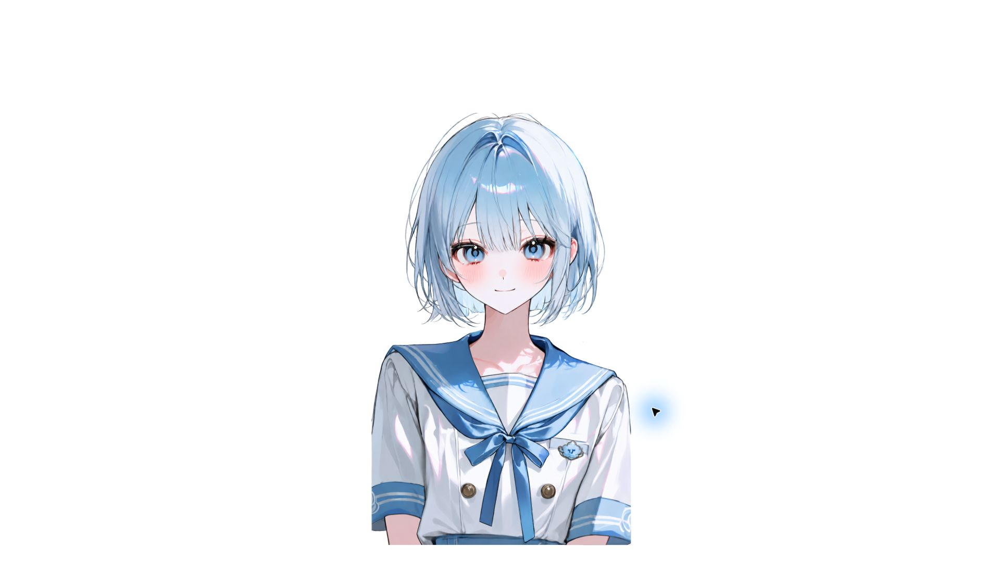
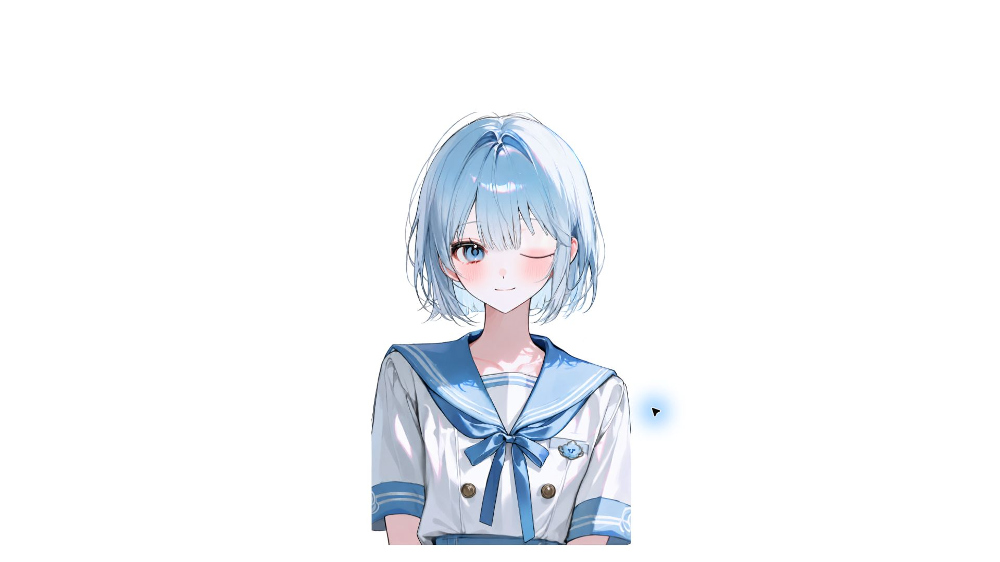
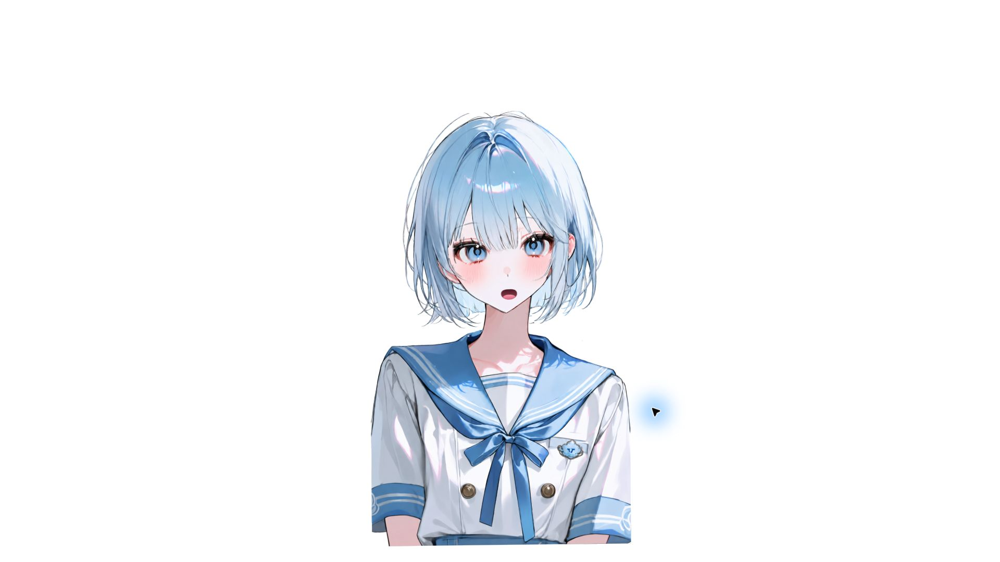
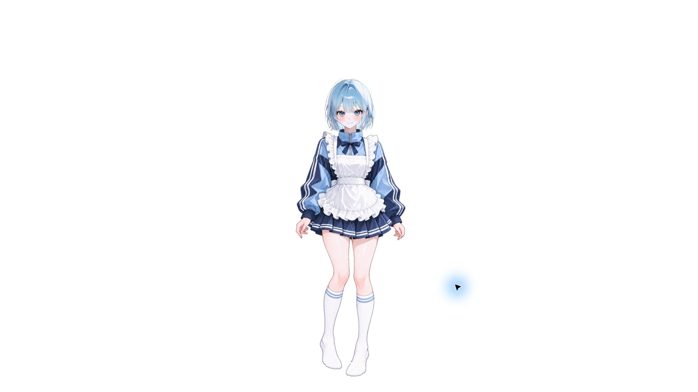
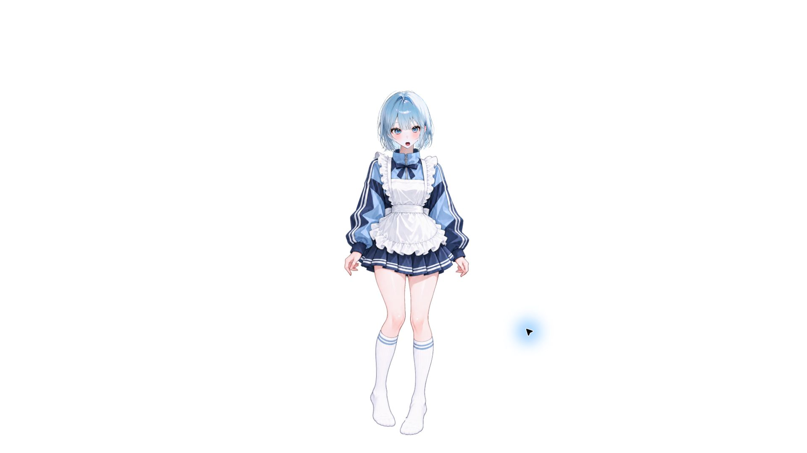

# VTube Studio 실제 실행 검증 — 2026-10-27

설치된 VTube Studio에서 **세일러복 V2와 메이드복 Detail 모델을 직접 로드**하고, 정면 → 한쪽 눈 감기 → 고개 회전·입 개방 → 중립 복귀를 확인했습니다. 아래 이미지는 실제 VTube Studio 창에서 촬영한 화면입니다.

테스트 입력은 VTube Studio 로컬 API의 `InjectParameterDataRequest`로 전달했습니다. **합성 추적 입력을 사용한 런타임 검증이며, iPhone Face ID 실기 녹화가 아닙니다.** 화면과 별도로 `CurrentModelRequest` 및 `Live2DParameterListRequest` 응답을 기록했습니다.

## 세일러복 V2

실행 모델: `BlueSailor V2` / `BlueSailor_V2_Expressions`.

### 정면

양눈 개폐 출력은 1, 입 개방 출력은 0, 머리 각도는 중립 상태입니다.

### 한쪽 눈 감기

`EyeOpenLeft=0`, `EyeOpenRight=1`을 입력했습니다. 실제 출력은 `ParamEyeLOpen=0`, `ParamEyeROpen=1`이었고 화면에서도 한쪽 눈만 감긴 것을 확인했습니다. 좌우 명칭은 API 기준입니다.

### 고개 회전 + 입 개방

입력은 `FaceAngleX=20`, `FaceAngleY=8`, `FaceAngleZ=-10`, `MouthOpen=0.8`입니다. 매핑을 거친 모델 출력은 약 `ParamAngleX=20`, `ParamAngleY=12`, `ParamAngleZ=-10`, `ParamMouthOpenY=0.8`로 확인됐습니다. 이 값은 모델 파라미터이며 원화의 실제 회전 각도를 보증하지 않습니다.

## 저지 메이드복 Detail

실행 모델: `BlueSailor Jersey Maid Detail` / `BlueSailor_JerseyMaid_Detail`.

### 정면

### 한쪽 눈 감기

같은 윙크 입력에 대해 `ParamEyeLOpen=0`, `ParamEyeROpen=1` 출력을 확인했습니다.

### 고개 회전 + 입 개방

세일러복과 같은 입력을 사용했습니다. 출력은 약 `ParamAngleX=20`, `ParamAngleY=12`, `ParamAngleZ=-10`, `ParamMouthOpenY=1.0`입니다. 입 개방 출력의 차이는 각 모델에 저장된 매핑을 통과한 결과이며, 동일 입력이 항상 동일 출력이 되는 것은 아닙니다.

## 이번 검사에서 확인한 것

- 두 모델 모두 실제 런타임 로드 성공.
- 정면·한쪽 눈 감기·회전과 입 개방의 화면 변화와 파라미터 출력 확인.
- 중립 입력으로 복귀했을 때 눈 1/1, 입 0, 머리 각도 약 0으로 복귀 확인.
- 설치된 두 MOC3의 SHA-256이 README에서 소개한 각 배포본의 MOC3와 일치.
- 촬영 후 합성 입력을 종료하고 처음 열려 있던 메이드복 모델로 복귀.

검사 수치와 파일 해시는 [공개용 API 검증 요약](vts-validation-2026-10-27.json)에 기록했습니다. 인증 토큰, 로컬 사용자 경로, 모델 내부 식별자는 포함하지 않았습니다.

## 검증 범위

이번 검사는 대표적인 세 가지 상태와 중립 복귀를 확인한 것입니다. 전체 파라미터 극단 조합, 장시간 물리 안정성, 5개 표정 전체, 음성 기반 립싱크, iPhone 연결과 지연을 새로 검증한 것은 아닙니다. 정지 캡처이므로 움직임의 연속성과 프레임 안정성까지 입증하지 않습니다.
